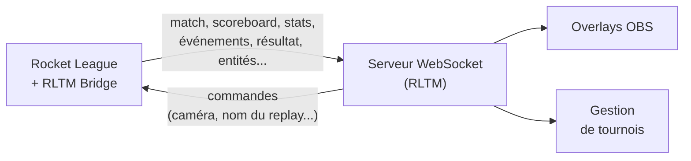

# RLTM Bridge

**RLTM Bridge** est un plugin [BakkesMod](https://bakkesmod.com) pour Rocket League. Il transmet en temps réel tout ce qui se passe dans un match à un serveur WebSocket, et permet au serveur de contrôler le jeu.

C'est le connecteur de jeu de **RLTM** (Rocket League Tournament Manager) : overlays OBS dynamiques, gestion de tournois avec les statistiques des joueurs et des équipes, replays nommés d'après les équipes de la série... mais n'importe quel serveur WebSocket peut l'utiliser.

## Fonctionnalités

**:material-broadcast: Données en direct**
:   État du match, tableau des scores, statistiques avancées (boost, supersonique, temps en l'air...), positions de la balle et des voitures, joueur suivi par la caméra spectateur.

**:material-flag-checkered: Événements et résultats**
:   Coups d'envoi, buts avec le buteur, le passeur et la vitesse de la balle, prolongation, replays, podium, et le résultat complet de chaque match.

**:material-remote: Contrôle par le serveur**
:   Centrer la caméra sur un joueur, nommer le replay d'après les équipes de la série, se marquer prêt... avec des commandes validées et limitées qui ne peuvent pas faire planter le jeu.

**:material-television: Prêt pour le stream**
:   Rejoindre automatiquement les spectateurs, masquer le HUD et les graphes de statistiques, se marquer prêt et sauvegarder le replay à la fin du match.

**:material-tune: Configurable**
:   Chaque fonctionnalité se règle dans la fenêtre de réglages du plugin ou depuis la console BakkesMod.

**:material-shield-check: Robuste**
:   Reconnexion automatique, l'état est renvoyé à chaque connexion, et le serveur ne peut pas ralentir le jeu.

## Par où commencer

- **Joueurs et casters** : [Démarrage](getting-started.md) pour installer le plugin et le connecter à un serveur, puis [Configuration](configuration.md).
- **Développeurs du serveur** : le [Protocole](protocol/index.md) décrit chaque message, et [Intégration serveur](integration.md) montre un serveur minimal.
- **Développeurs du plugin** : [Développement](development.md) présente le projet, la compilation et les tests.
