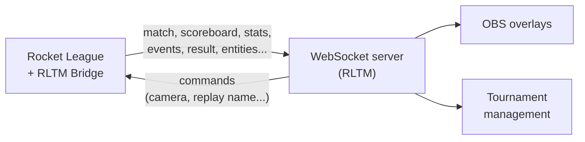

# RLTM Bridge

**RLTM Bridge** is a [BakkesMod](https://bakkesmod.com) plugin for Rocket League. It streams everything happening in a match to a WebSocket server in real time, and lets the server control the game.

It is the game connector of **RLTM** (Rocket League Tournament Manager): dynamic OBS overlays, tournament management with the statistics of the players and the teams, replays named after the teams of the series... but any WebSocket server can use it.

## Features

**:material-broadcast: Live data**
:   Match state, scoreboard, advanced statistics (boost, supersonic, air time...), positions of the balls and cars, player followed by the spectator camera.

**:material-flag-checkered: Match events and results**
:   Kickoffs, goals with the scorer, the assist and the ball speed, overtime, replays, podium, and the complete result of each match.

**:material-remote: Server control**
:   Focus the camera on a player, name the replay after the teams of the series, mark as ready... with validated, whitelisted commands that can't crash the game.

**:material-television: Ready for stream**
:   Automatically join the spectators, hide the HUD and the statistics graphs, mark as ready and save the replay at the end of the match.

**:material-tune: Configurable**
:   Every feature can be configured in the settings window of the plugin or from the BakkesMod console.

**:material-shield-check: Robust**
:   Automatic reconnection, the state is sent again on each connection, the server can't slow down the game.

## Where to start

- **Players and casters**: [Getting started](getting-started.md) to install the plugin and connect it to a server, then [Configuration](configuration.md).
- **Server developers**: the [Protocol](protocol/index.md) describes every message, and [Server integration](integration.md) shows a minimal server.
- **Plugin developers**: [Development](development.md) explains the project, the build and the tests.
