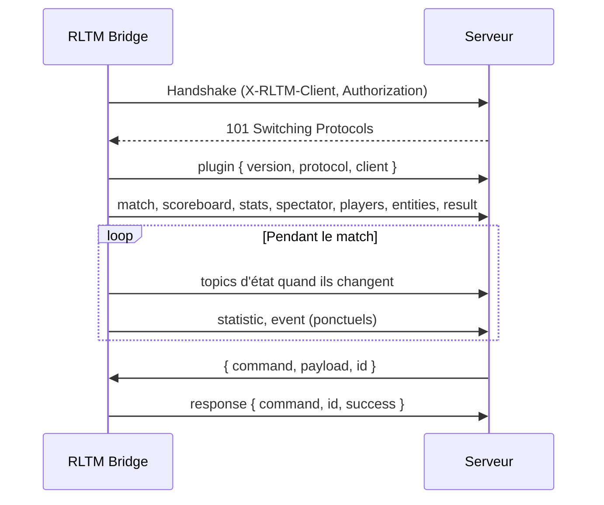

# Vue d'ensemble du protocole

Le plugin est un **client** WebSocket : il se connecte au serveur et envoie des messages texte JSON. Le serveur peut répondre avec des [commandes](commands.md).

Version actuelle du protocole : **2**. Elle est envoyée dans le message [`plugin`](messages.md#plugin) au début de chaque connexion : vérifiez-la pour vous assurer que le serveur comprend les messages.

## Connexion {#connection}

Le plugin se connecte à l'URL de ses réglages (`ws://` ou `wss://`), avec :

| | Valeur |
|---|---|
| Sous-protocole | `json` |
| Compression | Per message deflate (désactivable dans le plugin) |
| En-tête `X-RLTM-Client` | Nom du client : le nom du client des réglages, ou le nom de l'ordinateur |
| En-tête `Authorization` | `Bearer <jeton>`, seulement si un jeton est réglé dans le plugin |
| Ping | Chaque seconde (par défaut) |

Le serveur peut refuser la connexion pendant le handshake, par exemple si le jeton est inconnu. Le plugin se reconnecte automatiquement quand la connexion est perdue (toutes les 500 ms par défaut).

À chaque connexion, le plugin envoie d'abord le message [`plugin`](messages.md#plugin), puis la valeur actuelle de chaque topic d'**état** : un serveur connecté (ou redémarré) pendant un match est immédiatement à jour.



## Messages

Chaque message envoyé par le plugin est un objet JSON :

```json
{ "topic": "<topic>", "payload": <données> }
```

Il existe deux sortes de topics :

**Topics d'état**
:   La valeur actuelle de quelque chose : [`match`](messages.md#match), [`scoreboard`](messages.md#scoreboard), [`stats`](messages.md#stats), [`spectator`](messages.md#spectator), [`players`](messages.md#players), [`entities`](messages.md#entities) et [`result`](messages.md#result).

    Un état n'est **envoyé que lorsqu'il change**, et **renvoyé à chaque connexion** (et avec la commande [`resync`](commands.md#resync)). Gardez la dernière valeur de chaque topic : elle remplace la précédente.

    Un payload `null` signifie qu'il n'y a plus de donnée : le match est terminé (ou une donnée a été désactivée dans le plugin), effacez l'état correspondant. Le `result` est une exception : il est gardé après la fin du match.

**Topics ponctuels**
:   Quelque chose qui s'est produit : [`plugin`](messages.md#plugin), [`statistic`](messages.md#statistic), [`event`](messages.md#event) et [`response`](messages.md#response). Ils sont envoyés une seule fois, et sont perdus si le serveur n'est pas connecté à ce moment-là.

## Joueurs {#players}

Un joueur est identifié dans chaque topic par les mêmes champs :

| Champ | Type | Description |
|---|---|---|
| `uid` | string | Identifiant unique du compte du joueur, par exemple `Steam\|76561198000000000\|0`. Tous les bots ont le même `uid`. |
| `name` | string | Nom du joueur |
| `bot` | boolean | `true` pour un bot |
| `teamIndex` | number | `0` bleu, `1` orange, `255` spectateur (pas dans tous les topics) |

La **clé d'un joueur**, utilisée par les topics indexés par joueur (`scoreboard`, `stats`), est `"<uid>|<name>"` : le nom est nécessaire pour distinguer les bots.

## Replays {#replays}

À la fin de chaque match en ligne, le plugin envoie le replay du match au serveur, en **HTTP** (le WebSocket reste réservé aux données en direct). Le plugin attend le fichier sauvegardé par le jeu (jusqu'à 3 minutes), puis envoie :

```http
PUT /api/replays/<guid du match>?token=<token de l'URL> HTTP/1.1
Host: <hôte et port de l'URL WebSocket>
Content-Type: application/octet-stream
X-RLTM-Client: PC-CASTER-1
Authorization: Bearer <token>

<contenu du fichier .replay>
```

- L'URL est construite à partir de l'URL WebSocket : même hôte et même port, `http://` pour `ws://` et `https://` pour `wss://`, et seul le paramètre `token` de l'URL est gardé. `Authorization` n'est envoyé que si un token est réglé dans le plugin.
- `<guid du match>` est le [`guid`](messages.md#match) du match : lettres, chiffres et tirets. Un match sans guid (match hors ligne) n'a pas de replay.
- Le corps est le fichier `.replay` tel que sauvegardé par le jeu (généralement 1 à 3 Mo, 32 Mo au maximum).
- Une réponse `200` ou `201` signifie que le replay est reçu. Sans réponse, ou avec `408`, `429` ou `5xx`, le plugin réessaie 3 fois (après 5 s, 15 s et 60 s). Les autres codes ne sont pas réessayés.
- Le replay peut arriver avant ou après le [`result`](messages.md#result) du match : reliez-les avec le guid.
- L'envoi peut être désactivé dans le plugin (`rltm_upload_replays`), et le replay n'est sauvegardé par le jeu que si `rltm_auto_save_replays` est activé.

## Unités {#units}

| Donnée | Unité |
|---|---|
| Vitesses | km/h, arrondies |
| Positions | Unités Unreal `[X, Y, Z]`, arrondies. Le but bleu est du côté Y négatif, le but orange du côté Y positif. |
| Boost | `0` à `100` (un plein) |
| Durées | Secondes |
| `entities.time` | Millisecondes d'une horloge monotone : seule la différence entre deux envois a un sens |
| `result.endedAt` | Millisecondes depuis 1970 (temps Unix) |

## Versions {#versioning}

La version du protocole augmente à chaque changement incompatible (un champ ou un topic supprimé ou renommé). Des champs et des topics peuvent être ajoutés sans changer la version : **ignorez les champs et les topics inconnus**.

Un plugin antérieur au protocole 2 n'envoie jamais le message `plugin`. Voir l'[historique des versions](../changelog.md) pour les changements de chaque version.
