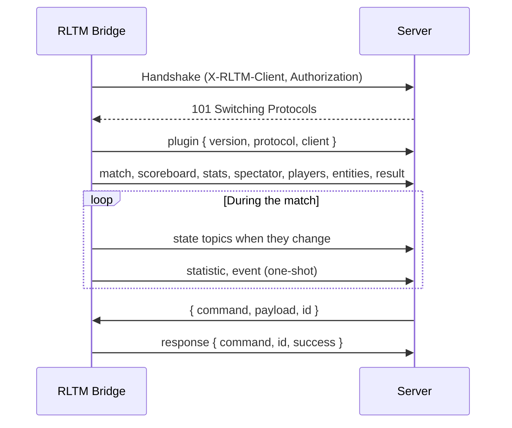

# Protocol overview

The plugin is a WebSocket **client**: it connects to the server and sends JSON text messages. The server can answer with [commands](commands.md).

Current version of the protocol: **2**. It is sent in the [`plugin`](messages.md#plugin) message at the beginning of each connection, check it to make sure the server understands the messages.

## Connection

The plugin connects to the URL of its settings (`ws://` or `wss://`), with:

| | Value |
|---|---|
| Subprotocol | `json` |
| Compression | Per message deflate (can be disabled in the plugin) |
| `X-RLTM-Client` header | Name of the client: the client name of the settings, or the name of the computer |
| `Authorization` header | `Bearer <token>`, only when a token is set in the plugin |
| Ping | Every second (by default) |

The server can reject the connection during the handshake, for example when the token is unknown. The plugin reconnects automatically when the connection is lost (every 500 ms by default).

On each connection, the plugin first sends the [`plugin`](messages.md#plugin) message, then the current value of every **state** topic, so a server connected (or restarted) during a match is up to date immediately.



## Messages

Every message sent by the plugin is a JSON object:

```json
{ "topic": "<topic>", "payload": <data> }
```

There are two kinds of topics:

**State topics**
:   The current value of something: [`match`](messages.md#match), [`scoreboard`](messages.md#scoreboard), [`stats`](messages.md#stats), [`spectator`](messages.md#spectator), [`players`](messages.md#players), [`entities`](messages.md#entities) and [`result`](messages.md#result).

    A state is **only sent when it changes**, and **sent again on each connection** (and with the [`resync`](commands.md#resync) command). Keep the last value of each topic: it replaces the previous one.

    A `null` payload means that there is no data anymore: the match is over (or a data was disabled in the plugin), clear the corresponding state. The `result` is an exception: it is kept after the end of the match.

**One-shot topics**
:   Something that happened: [`plugin`](messages.md#plugin), [`statistic`](messages.md#statistic), [`event`](messages.md#event) and [`response`](messages.md#response). They are sent once and never again, they are lost if the server isn't connected at that time.

## Players

A player is identified in every topic by the same fields:

| Field | Type | Description |
|---|---|---|
| `uid` | string | Unique ID of the player account, e.g. `Steam\|76561198000000000\|0`. All the bots share the same `uid`. |
| `name` | string | Name of the player |
| `bot` | boolean | `true` for a bot |
| `teamIndex` | number | `0` blue, `1` orange, `255` spectator (not in every topic) |

The **key of a player**, used by the topics indexed by player (`scoreboard`, `stats`), is `"<uid>|<name>"`: the name is needed to tell the bots apart.

## Replays

At the end of each online match, the plugin sends the replay of the match to the server, over **HTTP** (the WebSocket stays for the live data). The plugin waits for the file saved by the game (up to 3 minutes), then sends:

```http
PUT /api/replays/<match guid>?token=<token of the URL> HTTP/1.1
Host: <host and port of the WebSocket URL>
Content-Type: application/octet-stream
X-RLTM-Client: PC-CASTER-1
Authorization: Bearer <token>

<content of the .replay file>
```

- The URL is built from the WebSocket URL: same host and port, `http://` for `ws://` and `https://` for `wss://`, and only the `token` parameter of the URL is kept. `Authorization` is only sent when a token is set in the plugin.
- `<match guid>` is the [`guid`](messages.md#match) of the match: letters, digits and dashes. A match without guid (offline match) has no replay.
- The body is the `.replay` file as saved by the game (usually 1 to 3 MB, 32 MB at most).
- A `200` or `201` response means the replay is received. On no response, `408`, `429` or `5xx`, the plugin retries 3 times (after 5 s, 15 s and 60 s). Other statuses are not retried.
- The replay can arrive before or after the [`result`](messages.md#result) of the match: link them with the guid.
- Sending can be disabled in the plugin (`rltm_upload_replays`), and the replay is only saved by the game when `rltm_auto_save_replays` is enabled.

## Units

| Data | Unit |
|---|---|
| Speeds | km/h, rounded |
| Locations | Unreal units `[X, Y, Z]`, rounded. The blue goal is on the negative Y side, the orange goal on the positive Y side. |
| Boost | `0` to `100` (a full tank) |
| Times | Seconds |
| `entities.time` | Milliseconds of a monotonic clock: only the difference between two updates is meaningful |
| `result.endedAt` | Milliseconds since 1970 (Unix time) |

## Versioning

The protocol version is increased on each breaking change (a field or a topic removed or renamed). New fields and topics can be added without changing the version: **ignore the unknown fields and topics**.

A plugin older than the protocol 2 never sends the `plugin` message. See the [changelog](../changelog.md) for the changes of each version.
